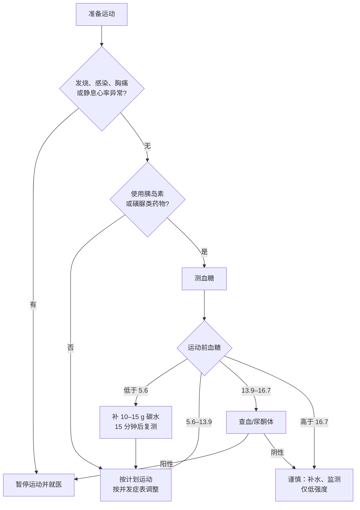

> ⚠️ **重要声明**：本文是循证文献的整理与解读，**不是医疗建议**，也不能替代你自己的医生。2 型糖尿病患者的运动方案必须结合病程、用药、并发症与体能个体化，尤其是**使用胰岛素或磺脲类药物、合并视网膜病变、周围神经病变、自主神经病变、慢性肾脏病或心血管疾病**的人。文中所有阈值与剂量，都请先与你的内分泌科医生或糖尿病教育护士核对，再决定是否执行。

> 📐 **本文的证据口径**：优先引用指南原文、系统综述与随机对照试验；每个数字尽量给出样本量与效应量。**元分析结论**与**单项试验结论**会明确区分。凡是证据互相矛盾的，我会把矛盾写出来，而不是替你选一个好看的答案。

---

## 序：一句正确但没用的话

如果你被诊断为 2 型糖尿病，大概会听到这样一句嘱咐：

> "管住嘴，迈开腿。"

这句话在方向上无懈可击，在信息量上等于零。迈多少？多快？一天里什么时候迈？吃到什么程度算管住？血糖多少的时候不能迈？打了胰岛素之后还按同样方式迈吗？

运动对 2 型糖尿病是有效的——这一点证据非常硬。但"有效"从来不等于"随便怎么动都有效"。同一批文献里，**结构化运动能让糖化血红蛋白（HbA1c）下降 0.67 个百分点**，而**仅仅给出"多活动"的建议，在单独使用时对 HbA1c 没有显著影响**（Umpierre 等，JAMA 2011，47 项 RCT、8538 人）。

也就是说：**运动是一味药，而"多运动"是一句没有剂量的处方。** 没有剂量的处方，执行不了，也评估不了。

这篇文章想做的事，是把"迈开腿"拆成四个可以回答的问题：

1. **练多少**——总量、强度、频率；
2. **练什么**——有氧、抗阻、联合，各自的证据与分工；
3. **什么时候练**——餐后、空腹、早晨、傍晚；
4. **什么情况下不能练**——血糖阈值、并发症、药物交互。

最后给一份可以直接抄走的周计划，以及一张记录表。

---

## 一、先把问题拆开：你要的是哪一种"有效"

在讨论任何运动方案之前，必须先明确目标。临床上至少有三个不同的目标，它们的处方并不相同，有时还会互相冲突：

| 目标 | 主要看什么指标 | 最有效的运动类型 | 时间尺度 |
|---|---|---|---|
| 降血糖 | HbA1c、餐后血糖、目标范围内时间（TIR） | 有氧为主，联合抗阻 | 8–12 周起效 |
| 改善身体成分 | 体重、腰围、内脏脂肪、肌肉量 | 有氧 + 抗阻 + 饮食 | 12 周以上 |
| 降低长期风险 | 心肺适能、血压、血脂、死亡率 | 任何能长期坚持的中高强度活动 | 数年到数十年 |

这三件事不是一回事。一个人可能 HbA1c 降了 0.5%，体重一斤没掉；也可能体重掉了 8 公斤，但肌肉一起掉，血糖反而更难控。**只盯着体重秤，是这类文章最常见的误导。**

还有一个更容易被忽略的事实：**心肺适能（cardiorespiratory fitness）本身就是独立于 BMI 的死亡风险预测因子。** 一项纳入 2196 名糖尿病男性的队列研究里，体能最低四分位者的全因死亡风险是最高的四分位的 **4.5 倍**（95% CI 2.6–7.6），而且在正常体重、超重、肥胖各层里都成立（Church 等，Diabetes Care 2004）。

换句话说：**"体重正常但体能很差"并不是安全状态。** 这也是为什么后文的处方里，抗阻训练和心肺适能被放在和减重同等重要的位置。

---

## 二、机制：肌肉是人体最大的葡萄糖仓库

要理解为什么运动能降糖，只需要记住一件事：**餐后进入血液的葡萄糖，主要去向是骨骼肌。**

安静状态下，骨骼肌的血流约占心输出量的 20%；中等至较大强度运动时，这个比例可以升到 70%–80%（《中国 2 型糖尿病运动治疗指南（2024 版）》第十一章）。血流增加带来两件事：更多的葡萄糖被送到肌肉，以及更多的胰岛素被送到肌肉。

更关键的是机制上的一个分叉：

- **胰岛素依赖的葡萄糖摄取**：胰岛素信号让 GLUT4 转运体上膜，把葡萄糖搬进细胞。2 型糖尿病的核心问题之一，就是这条通路变钝了（胰岛素抵抗）。
- **不依赖胰岛素的葡萄糖摄取**：肌肉收缩本身就能通过 AMPK 等通路触发 GLUT4 上膜。**这条路在胰岛素抵抗的状态下依然通畅。**

这就是为什么"动起来"这件事，对 2 型糖尿病有药物之外的意义：它绕开了坏掉的那条路。

运动结束后，效应并不会立刻消失。一次有氧运动带来的胰岛素作用改善，**可以持续约 2–72 小时**；肌肉对葡萄糖的摄取在运动后约 2 小时内显著升高，而胰岛素敏感性的改善可以延续到 48 小时甚至更久（ACSM/ADA 2010 联合立场声明；Way 等，Diabetes Metab J 2016 的元分析也显示 48–72 小时后仍可测得改善）。

这条机制直接推出一个处方原则，中国 2024 版指南把它写成了硬性建议：

> **两次运动之间的间隔不应超过 2 天。**

不是因为"勤快"，而是因为**胰岛素敏感性的窗口大约就是两天**。周一练完，周四才练第二次，中间那段窗口已经关上了。

```text
一次运动的降糖效应（示意）

胰岛素敏感性
   │        ┌──────────────┐
   │       ╱                ╲
   │      ╱                  ╲
   │─────╱────────────────────╲──────────  基线
   └──────┬──────┬──────┬──────┬──────────▶ 时间
         0h    24h    48h    72h
               └── 有效窗口 ──┘
         （因此建议间隔 ≤ 2 天）
```

---

## 三、剂量：A1C 能降多少，以及为什么不是越多越好

### 3.1 一张效应量表

先把"运动到底能降多少"这件事说清楚。以下是几项高质量元分析的主要结果。**注意：不同元分析纳入的人群、干预方式和对照不同，数字不能直接横向比较。**

| 干预 | HbA1c 变化 | 证据来源 | 备注 |
|---|---|---|---|
| 结构化运动（总体） | **−0.67%**（95% CI −0.84 ~ −0.49） | Umpierre 2011，JAMA，47 RCT / 8538 人 | 异质性极高（I² = 91.3%） |
| 仅结构化有氧 | −0.73%（−1.06 ~ −0.40） | 同上 | 置信区间与抗阻重叠 |
| 仅结构化抗阻 | −0.57%（−1.14 ~ −0.01） | 同上 | 下限几乎贴着零 |
| 有氧 + 抗阻联合 | −0.51%（−0.79 ~ −0.23） | 同上 | 异质性较低（I² = 67.5%） |
| 结构化运动 >150 min/周 | **−0.89%** | 同上（亚组） | 与 ≤150 min/周 的 −0.36% 对比 |
| 仅"体力活动建议" | 无显著变化 | 同上 | 必须叠加饮食建议才有效（−0.58%） |
| 监督下有氧，100 min/周 | **−0.96%**（−1.25 ~ −0.67） | Jayedi 2022，Sports Med，26 RCT / 1253 人 | 每增加 30 min/周，多降 0.22 个百分点；超过 100 min/周后曲线趋平 |
| 抗阻训练 | **−0.39%**（−0.60 ~ −0.18） | Jansson 2022，BMJ Open Diabetes Res Care，20 研究 / 1172 人 | 肌力提升幅度是显著调节因子 |
| 抗阻 vs 有氧（头对头） | 差异不显著（p = 0.42） | 同上 | 13 研究 / 640 人 |
| 网络元分析：HIIT | −0.61%（95% CrI −0.84 ~ −0.37） | Garcia 2025，Diabetes Res Clin Pract，158 研究 / 17059 人 | 排名第一，但模式间差异多不显著 |
| 网络元分析：联合训练 | −0.58%（−0.73 ~ −0.42） | 同上 | |
| 网络元分析：有氧 | −0.58%（−0.70 ~ −0.45） | 同上 | |
| 网络元分析：抗阻 | −0.40%（−0.59 ~ −0.21） | 同上 | |
| 网络元分析：仅建议 | −0.35%（−0.53 ~ −0.16） | 同上 | 比旧 meta 乐观，但仍最小 |

把这些数字放在一起，可以得出三个结论。

**第一，运动对 HbA1c 的效应量大约在 0.4–0.9 个百分点之间。** 这不算小：UKPDS 35 的队列分析显示，HbA1c 每降低 1 个百分点，任何糖尿病相关终点的风险降低 **21%**，心肌梗死降低 **14%**，微血管并发症降低 **37%**。反过来说，也不要指望运动单独把 9% 的 HbA1c 拉到 6%——那通常需要药物、饮食、减重一起上。

**第二，>150 分钟/周是一个分水岭，但不是唯一的分水岭。** Umpierre 的亚组分析里，>150 min/周 降 0.89%，≤150 min/周 只降 0.36%。但 Jayedi 的剂量-反应分析显示，**监督下的有氧运动在 100 分钟/周左右就已经接近最大效应**，之后曲线变平。两个结论并不完全一致，原因很可能是人群与监督强度不同。实操上可以这样理解：**150 分钟是公共指南的底线，100 分钟是"至少要做够"的起点，再往上收益递减但不为零。**

**第三，"强度越高越好"在 12 周这个尺度上并不成立。** 一项纳入 16 项研究、干预 ≥12 周的有氧运动元分析发现，干预强度、每周分钟数、总训练小时数，**都与 HbA1c 改善没有显著关联**（Wrench 2022，Acta Diabetologica，p = 0.96 / 0.116 / 0.853）。作者的解释是：纳入研究的强度范围太窄（50%–75% 最大运动能力），随访也太短（中位 12 周），所以看不到剂量-反应。

这里要诚实：**"剂量-反应"在文献里是有争议的。** 有的元分析看到明确的平台期（Jayedi），有的完全看不到（Wrench），有的给出一个最优剂量（Gallardo-Gómez 2024：**1100 MET·min/周**）。对普通人来说，正确的结论不是"记住 1100 这个数字"，而是：**先做够 150 分钟，再考虑加量；加量之前，先确认自己还在坚持。**

### 3.2 基线越高，降幅越大

这一点在临床上有实际意义：**HbA1c 越高的人，运动带来的绝对降幅越大。**

Gallardo-Gómez 等（Diabetes Care 2024，126 项研究 / 6718 人）按基线血糖状态分层，在最优剂量（1100 MET·min/周）下给出的降幅是：

| 基线状态 | HbA1c 降幅 |
|---|---|
| 重度未控制 | −1.02% ~ −0.66% |
| 未控制 | −0.64% ~ −0.49% |
| 已控制 | −0.47% ~ −0.40% |
| 糖尿病前期 | −0.38% ~ −0.24% |

这解释了一个常见的困惑：两个人都按同样的方案练，一个人降了 1%，另一个人只降了 0.3%。那不是后者"练得不对"，而是**起点不同，天花板也不同**。基线已经 6.8% 的人，本来就没有多少下降空间。

### 3.3 一个容易被忽略的变量：你到底练到了没有

上面所有数字都有一个前提：**参与者真的完成了训练。**

现实是，这个前提经常不成立。一项针对糖尿病运动干预依从性的系统综述发现，依从率范围从 **32% 到 100%，中位数只有 58%**；观察性研究报告的依从率（92%）显著高于随机对照试验（55%）（MacDonald 等，Diabetes Metab Res Rev 2021）。另一项为期 12 个月的 RCT 里，**只有 37%–44% 的参与者坚持到了最后**，脱落原因中约一半是骨科共病或过度使用损伤，四分之一是缺乏动机（Praet 等，Diabetologia 2008）。

所以，第十节会专门讲"怎么让方案活下来"。**一个能坚持的 100 分钟方案，胜过一个坚持不了的 300 分钟方案。**

---

## 四、三种运动的分工

### 4.1 有氧：降糖的主力，但不是全部

有氧运动是证据最厚的一类。中国 2024 版指南的推荐是：

- **频率**：每周 3–7 天，两次之间不超过 2 天；
- **强度**：以中等强度为目标，体能较好者可到较大强度；
- **时间**：每次不少于 10 分钟，每天累计 30–60 分钟，每周累计至少 150 分钟；
- **总量**：每周 150–300 分钟中等强度，或 75–150 分钟较大强度，或等效组合；每周超过 300 分钟中等强度可获更多益处；
- **量化替代**：每周至少 1000 kcal 的体力活动消耗；或 8.5–17.0 MET·h/周。

一个常被问到的细节：**必须一次练满 30 分钟吗？** 不必。指南明确写了"可连续完成，也可分次累计"，每次不少于 10 分钟即可。这一点在第五节讲餐后运动时会更重要——**把 30 分钟拆成三次 10 分钟，不但更可行，降餐后血糖的效果还更好。**

### 4.2 抗阻：被低估的一半

如果只做有氧，你大概率能降 HbA1c，但会漏掉三样东西：**肌肉量、肌力、以及老年期的功能储备。**

抗阻训练的证据同样明确：

- 元分析显示抗阻训练使 HbA1c 下降 **0.39%**（Jansson 2022）；
- **肌力提升的幅度，是抗阻训练降糖效果的显著调节因子**（β = −0.99，p = 0.047）——练得越有劲，降得越多；
- 抗阻与有氧头对头比较，**降糖差异不显著**（p = 0.42）；
- 在老年 2 型糖尿病人群中，抗阻训练带来力量、骨密度、瘦体重、血压、血脂与胰岛素敏感性的改善；与单纯限热量减重相比，**联合抗阻训练者的 HbA1c 降幅可达三倍**（ACSM 2022 共识声明）。

中国 2024 版指南的处方是：

- **频率**：每周 2–3 天，同一肌群间隔至少 1 天；
- **无经验者**：从 20% 1-RM 负荷开始，每周 1 次全身大肌群训练；开始的前 12 周，每次多关节练习 <3 组、强度不超过 50% 1-RM；
- **进阶**：当你能连续两次轻松完成当前次数时，负荷增加 2%–10%；
- **动作**：徒手、器械、弹力带均可，覆盖上肢、下肢、躯干主要肌群。

为什么抗阻训练在 2 型糖尿病里越来越被重视？除了肌肉是葡萄糖的主要去处，还有一个现实背景：**GLP-1 受体激动剂类减重药物普及之后，"减重同时丢肌肉"成了一个真实的问题。** 中国指南专门写了一条：使用 GLP-1RA 的患者应合理饮食、适当增加蛋白摄入、合理运动，以减少肌肉组织丢失（推荐意见 64，C 级）。抗阻训练在这里不是可选项。

### 4.3 联合：方向一致，但别指望"1+1=2"

几乎所有指南都推荐有氧 + 抗阻联合。但证据的强度需要说清楚：

- 网络元分析里，联合训练的降幅通常排在前列（Garcia 2025：−0.58%；Michielsen 2025：−0.74%）；
- 但多项分析显示，**联合与单一模式之间的差异通常很小，且多未达统计显著**；
- 一项经典的单项 RCT（Church 2010，JAMA，n = 262，9 个月）里，**只有联合组显著降糖（−0.34%），有氧组（−0.24%）与抗阻组（−0.16%）单独均不显著**——但联合组的总运动量也最大，所以无法区分"协同效应"与"总量更大"。

比较诚实的表述是：**联合训练的最大价值不在于多降零点几个百分点的 HbA1c，而在于它同时改善心肺适能、肌力、体成分与功能状态。** 这些指标各自独立地与长期预后相关。

### 4.4 HIIT：时间效率是真的，神奇是假的

高强度间歇训练（HIIT）在 2 型糖尿病里被讨论得很多，因为它的时间效率高：20–30 分钟就能完成一次有效刺激。

数据是这样的：

- HIIT 对比不运动：HbA1c 降 **0.61%–0.80%**（多项元分析）；
- HIIT 对比中等强度持续训练（MICT）：**多数指标无显著差异**。一项直接头对头元分析（21 项试验 / 792 人）里，HbA1c 的 SMD 为 **0.00**（95% CI −0.19 ~ 0.19），只有 HDL 略优；
- HIIT 的确定优势在**心肺适能**：VO₂max 提升比 MICT 多 1.7–4.1 mL/kg/min；
- 代价是依从性：一项纳入 23 项 RCT 的元分析显示，**高强度方案的脱落风险是中等强度的 1.81 倍**（OR 1.81，95% CI 1.12–2.91）。

所以 HIIT 的定位应该是：**给已经规律运动、体能尚可、时间紧张的人一个可选的加速器**，而不是给久坐十年的初学者开的起点。中国指南的措辞也是这个意思：病情稳定、体质状态较好者可考虑用 HIIE 替代持续有氧；**伴有并发症者进行 HIIE 前应先做风险筛查**（推荐意见 27、28）。

### 4.5 柔韧与平衡：不降糖，但防跌倒

柔韧训练单独对血糖没有显著影响，这一点指南写得很直白。但它对老年人有另一重价值：**关节活动度、平衡能力、跌倒风险。**

中国指南建议：**每周 2–3 天**的平衡及柔韧性练习；太极拳、八段锦这类多组分运动，在老年人中依从性更高，且对肌少症患者的肌肉量、肌力与身体功能有改善（推荐意见 23、52、53）。

对 65 岁以上、或合并周围神经病变的人来说，**一次跌倒的代价，可能超过半年的血糖收益**。这部分不该被"降糖"两个字挤掉。

---

## 五、时机：餐后 10 分钟，可能比每天 30 分钟更值

这是过去十年里，2 型糖尿病运动研究中最实用的一组发现。

### 5.1 同样走 30 分钟，拆到三餐后效果更好

2016 年发表在《Diabetologia》上的一项随机交叉试验（Reynolds 等，n = 41，平均病程 10 年，HbA1c 7.5%）做了这样一件事：

- A 组：每天一次 30 分钟步行，时间不限；
- B 组：每餐后 10 分钟步行，**进食结束后 5 分钟内开始**，一天三次；
- 两组总步行时间完全相同（30 分钟/天），用加速度计确认执行，用连续血糖监测（CGM）测量。

结果是：

| 指标 | 结果 |
|---|---|
| 全部餐次餐后 3 小时血糖 iAUC | **降低 12%**（几何均值比 0.88，95% CI 0.78–0.99，p = 0.031） |
| 晚餐后 iAUC | **降低 22%**（0.78，95% CI 0.67–0.91，p = 0.001） |
| 晚餐后 3 小时平均血糖 | **−0.50 mmol/L**（95% CI −1.0 ~ −0.04） |
| 空腹血糖、7 天平均血糖、血糖波动 | 无显著差异 |

注意这个设计的巧妙之处：**两组的总运动量是一样的。** 差别只在于"什么时候走"。而晚餐后的改善最明显——晚餐通常碳水最多、饭后活动最少。

### 5.2 打断久坐：每 30 分钟起身 3 分钟

如果餐后运动是"把一次运动放对时间"，那么打断久坐就是"把运动拆成很多次"。

最直接的一项证据来自 Dempsey 等（Diabetes Care 2016，n = 24，2 型糖尿病，随机交叉）：让参与者在实验室里坐 8 小时，比较三种条件——不间断久坐、每 30 分钟起身做 3 分钟轻强度步行、每 30 分钟做 3 分钟简单抗阻动作。结果：

- 葡萄糖 iAUC：不间断久坐 24.2 → 轻步行 **14.8**、简单抗阻 **14.7** mmol/L·h（均 p < 0.001），**降幅约 39%**；
- 胰岛素、C 肽同步显著下降；
- 甘油三酯仅在抗阻条件下显著下降。

同一组参与者的 22 小时 CGM 扩展分析（Dempsey 2017，Diabetologia）更进一步：**夜间平均血糖从 10.6 降到 8.1–8.3 mmol/L，次日晨起血糖比对照低 2.7 mmol/L。** 也就是说，打断久坐的效应能延续到第二天早上。

一个常见的误传需要纠正：**"每 30 分钟起身 3 分钟"来自 Dempsey 2016；Dunstan 2012 的经典研究是"每 20 分钟起身 2 分钟"**（n = 19，超重/肥胖非糖尿病人群，葡萄糖 iAUC 降 24%–30%）。两篇都很重要，但方案不同，不能混着引用。

### 5.3 时机到底该选"餐后多久"

这是文献里最不一致的部分，必须把矛盾摆出来：

| 证据 | 结论 |
|---|---|
| Engeroff 2023（Sports Med，8 项交叉试验 / 116 人） | 餐后运动优于餐前（SMD 0.47）；餐后 vs 不运动 SMD 0.55；**餐前运动 vs 不运动不显著**；餐与运动的间隔越短效果越好（p = 0.001） |
| Kang 2023（Nutrients，31 项研究 / 516 人） | 餐后运动降低餐后血糖 AUC（g = −0.317）与 24 小时平均血糖（g = −0.328）；**单次 >30 分钟优于 ≤30 分钟**；24 小时平均血糖在"餐后 ≥60 分钟开始"时更优 |
| Reynolds 2016 | 每餐后 10 分钟，优于每天一次 30 分钟 |
| Bellini 2021（n = 13，健康人） | 仅"餐后 15 分钟开始"显著削弱血糖峰值 |
| 中国 2024 指南推荐意见 70 | 单次傍晚运动可更好改善夜间血糖；**餐后 30 分钟进行 HIIE 可更好降低餐后血糖峰值（B 级）**；餐后 60 分钟运动可减少低血糖风险（E 级） |

把这些放在一起，实用的折中是：

> **餐后 15–30 分钟内起身，做 10–15 分钟低至中等强度活动。**
>
> 晚餐后这一顿最值得做。使用胰岛素或磺脲类药物、低血糖风险较高的人，可以稍微推迟到餐后 30–60 分钟，并把强度控制在中等以下。

需要强调的是：**上面这些研究测的几乎都是"急性餐后血糖"，不是 HbA1c。** Reynolds 2016 里糖化白蛋白与 HbA1c 都没有显著变化。餐后运动的证据强度，在于它**即时、可感知、容易坚持**，而不在于它能单独替代总量。

### 5.4 早晨还是傍晚

这个问题没有干净答案，但方向偏向傍晚：

- Savikj 2019（Diabetologia，n = 11 男性，随机交叉）：**早晨 HIIT 反而升高了 CGM 平均血糖**（运动周 6.9 vs 训练前 6.4 vs 下午 HIIT 6.2 mmol/L）；
- Keller 2025（n = 48，含 24 名 2 型糖尿病）：24 小时血糖谱在早晨与下午之间**无差异**，但 2 型糖尿病组**早晨运动后 2 小时血糖升高**，下午运动则没有；
- 中国 2024 版指南的表述是"单次傍晚运动可更好地改善夜间血糖"。

但也要看到反面：一项 12 周、每周 3 次监督训练的研究里，**8–10 点与 17–19 点运动没有明显差异**。所以更准确的说法是：**如果你只能在早晨练，那就早晨练；如果时间自由，傍晚略优。** 不要为了"最优时机"而不练。

---

## 六、强度：三种尺子，以及它们什么时候会骗你

### 6.1 心率：公式、储备心率与靶区间

最常用的两个公式：

- **最大心率**：HRmax = **207 − 0.7 × 年龄**（中国 2024 指南采用；比"220 − 年龄"更接近现代数据）
- **储备心率**：HRR = HRmax − 安静心率
- **靶心率**：靶心率 = HRR × 目标强度% + 安静心率

举例：55 岁，安静心率 72 次/分。

```text
HRmax = 207 − 0.7 × 55 = 168.5 ≈ 169
HRR   = 169 − 72 = 97
中等强度（40%–59% HRR）：
  下限 = 97 × 0.40 + 72 = 111
  上限 = 97 × 0.59 + 72 = 129
→ 目标心率约 111–129 次/分
```

中国指南的强度分级（附录 10）大致是：

| 强度 | %HRR | %HRmax | RPE（6–20） | MET |
|---|---|---|---|---|
| 低 | <30% | <57% | <9 | <2.0 |
| 较低 | 30–39% | 57–63% | 9–11 | 2.0–2.9 |
| **中等** | **40–59%** | **64–76%** | **12–13** | **3.0–5.9** |
| 较大 | 60–89% | 77–95% | 14–17 | 6.0–8.7 |
| 次最大–最大 | ≥90% | ≥96% | ≥18 | ≥8.8 |

### 6.2 RPE：心率不可靠时的替代品

主观用力感觉（RPE）用 0–10 或 6–20 量表。**0–10 量表里，5–6 分是中等强度，7–8 分是较大强度；6–20 量表里，12–13 分是中等，14–17 分是较大。**

以下情况应该用 RPE，而不是心率：

- 服用 **β 受体阻滞剂**：心率被压低，按公式算出来的靶心率会严重低估实际强度；
- **自主神经病变**：心率反应迟钝，静息心率升高、最大心率下降；
- **视网膜病变**：指南直接建议用 RPE 10–12（6–20 量表）监测；
- 房颤或其他心律失常。

### 6.3 谈话试验：最便宜的那把尺子

一句话版本：

- **能说话也能唱歌** = 低强度；
- **能说话但不能唱歌** = 中等强度；
- **说不出完整句子** = 较大强度。

中国指南明确写了谈话试验"可以代替乳酸阈、通气阈和呼吸补偿点"，作为制定和监测运动强度的主要方法之一。对没有手表、没有心率带的人，这是最实用的工具。

---

## 七、一周怎么排：三档模板

以下模板是**结构示例**，不是给你照抄的处方。开始之前请对照第八节的安全边界。

### 7.1 第一档：从零开始（久坐、年龄较大、或刚被诊断）

目标不是"练出效果"，是**建立不受伤的习惯**，前 4 周不追求强度。

| 时间 | 内容 | 时长 |
|---|---|---|
| 每天 | 三餐后散步 | 每餐 10 分钟 |
| 周一、周四 | 弹力带全身训练：坐站、靠墙俯卧撑、弹力带划船、提踵、臀桥 | 每个动作 1–2 组 × 10–12 次 |
| 周二、周五 | 快走（能说话但不能唱歌的速度） | 20 分钟 |
| 周三、周六 | 平衡与柔韧：单腿站立（扶墙）、小腿拉伸、胸椎旋转 | 10 分钟 |
| 每小时 | 起身活动 2–3 分钟 | — |

第 5–8 周：快走加到 30 分钟；抗阻每个动作加到 2 组。第 9–12 周：如果膝关节和足部没有不适，快走中加入 1–2 分钟的快慢交替。

### 7.2 第二档：稳定期（已能规律运动，无严重并发症）

| 时间 | 内容 | 时长/强度 |
|---|---|---|
| 周一 | 有氧：快走/骑车/游泳 | 40 分钟，中等强度 |
| 周二 | 抗阻：下肢 + 推 | 30 分钟，2–3 组 × 10–12 次 |
| 周三 | 有氧（低冲击） | 30 分钟 |
| 周四 | 抗阻：拉 + 核心 | 30 分钟 |
| 周五 | 有氧 | 40 分钟 |
| 周六 | 抗阻（全身，轻负荷）或太极/八段锦 | 30–40 分钟 |
| 周日 | 休息或散步 | — |
| 每天 | 餐后 10–15 分钟步行；每 30 分钟打断久坐 | — |

有氧合计约 150–180 分钟；抗阻 3 次；餐后步行另计。

### 7.3 第三档：时间极紧（每周只能挤出 3 次，每次 30 分钟）

| 时间 | 内容 |
|---|---|
| 周一 | 10 分钟快走 + 15 分钟循环抗阻（深蹲、俯卧撑、划船、平板支撑，各 40 秒，间歇 20 秒，做 3 轮） |
| 周三 | 20 分钟快慢交替（快走 3 分钟 / 慢走 1 分钟 × 5） |
| 周五 | 同周一，动作换一组 |
| 每天 | 三餐后各 10 分钟步行（这部分不占额外时间，饭后本来就要走动） |

**如果一周只能做一件事，做餐后步行。** 它的时间成本最低、即时反馈最强、对餐后血糖的证据最直接。

---

## 八、安全边界：阈值、并发症与一张决策图

这一节比前面所有内容都重要。**运动的风险不在于"动"，而在于"在不该动的时候动"。**

### 8.1 运动前评估：谁需要先看医生

中国 2024 版指南给出的风险人群（表 1）是：

| 条件 | 具体说明 |
|---|---|
| 年龄 >40 岁 | 有糖尿病，有或无其他心血管危险因素 |
| 年龄 >30 岁，且符合任一项 | 病程 >10 年；高血压；吸烟；血脂异常；增殖性或增殖前期视网膜病变；慢性肾脏病 |
| 不论年龄，符合任一项 | 已知或疑似心血管/冠状动脉/外周动脉疾病；自主神经病变；晚期肾病伴肾衰竭 |

配套的推荐是：**低风险、无心血管或微血管并发症、只计划做低至中等强度运动（如快走）的人，不需要运动前医学评估**（A 级）；久坐或合并多种慢性疾病的高风险者，参加中等及以上强度运动前建议评估（A 级）。

ADA 的立场更保守一点：无症状者**不推荐常规筛查冠心病**，但需要仔细询问病史、评估心血管危险因素，并注意"运动耐量近期下降"这种不典型表现。

### 8.2 运动前的血糖阈值

这是最容易出错、也最需要说清楚的一张表。

**ADA 2016 立场声明的五段式表格**（原表针对 1 型糖尿病，2 型可作参考）：

| 运动前血糖 | 建议动作 |
|---|---|
| **<5.0 mmol/L（<90 mg/dL）** | 先摄入 15–30 g 速效碳水；<30 分钟的短时运动或极高强度运动可能无需补糖；长时间中等强度运动按需补 0.5–1.0 g/kg/h |
| 5.0–8.3 mmol/L（90–150 mg/dL） | 多数运动开始即补充碳水（约 0.5–1.0 g/kg/h），视运动类型与体内活性胰岛素量而定 |
| 8.3–13.9 mmol/L（150–250 mg/dL） | 可以开始运动，但推迟补碳水，直至血糖降至 <8.3 mmol/L |
| 13.9–19.4 mmol/L（250–350 mg/dL） | **查酮体**。中等至大量酮体时禁止运动；可开始轻至中等强度运动；剧烈运动应推迟至血糖 <13.9 mmol/L |
| **≥19.4 mmol/L（≥350 mg/dL）** | **查酮体**。中等至大量酮体时禁止运动；酮体阴性或微量时，可考虑保守的胰岛素校正后开始轻至中等强度运动，避免剧烈运动 |

**中国 2 型糖尿病指南的阈值**（更适合中国人群的 T2D 实践）：

| 来源 | 阈值与动作 |
|---|---|
| 运动治疗指南 2024，推荐意见 34 | 血糖 **>13.9 mmol/L** → 监测血/尿酮体；酮体阳性 → 不宜进行中等及以上强度运动；无高血糖症状时，可从低强度逐步开始 |
| 同上，第八章 | 血糖 **>16.7 mmol/L** → 无论是否合并酮症，均应谨慎运动 |
| 运动治疗指南 2024，推荐意见 61 | 使用胰岛素促泌剂者，运动前血糖 **<5.6 mmol/L** → 依计划运动的强度与时间补充适量碳水；避免在药物作用峰值时运动 |
| 糖尿病防治指南 2024 | 运动前血糖宜在 **5.0–13.9 mmol/L**；**≥16.7 mmol/L、<3.9 mmol/L、血糖波动大、急性并发症、增殖型视网膜病变、严重肾病或严重心脑血管疾病**时，禁止中等及以上强度运动 |

一个必须纠正的流传说法：**"运动前血糖 <5.6 / 5.6–7.8 / 7.8–13.9 / ≥13.9"的四段式表格，查不到 ADA 原始出处。** 真正可核查的是上面的五段式（ADA）与中国指南的分档阈值。写科普时把两套数字混在一起，是最常见的错误来源。

### 8.3 低血糖：谁有风险，怎么处理

**只有使用胰岛素或胰岛素促泌剂（磺脲类、格列奈类）的人，才有临床意义上的运动相关低血糖风险。** 单用二甲双胍、α-糖苷酶抑制剂、DPP-4 抑制剂、GLP-1RA 或 SGLT2i 的人，低血糖风险很低，不需要常规的预防性加餐。

需要记住的时间窗：

- 低血糖事件通常发生在**运动后 6–15 小时**内，夜间是高峰；
- 一次运动带来的胰岛素敏感性提升可持续 48 小时以上，所以**运动后第二天**仍可能低血糖；
- 因此，晚间运动后应特别关注睡前与夜间血糖。

处理原则（ADA "15-15 规则"）：

1. 血糖 ≤3.9 mmol/L（或 ≤70 mg/dL）时，摄入 **15 g** 速效碳水（葡萄糖片、含糖饮料、果汁）；
2. **15 分钟后复测**；
3. 仍低则重复；恢复后若距离下一餐还久，再补充含蛋白质与复合碳水的小食；
4. **血糖回到 5.6 mmol/L 以上再恢复运动**（不同机构给出的恢复阈值略有差异，ADA 患者版写的是 ≥100 mg/dL）。

中国指南给出的数字是：运动中或迟发低血糖时立即进食 **10–15 g** 碳水，15 分钟后仍 <3.9 mmol/L 再加同等量；**15 g 葡萄糖大约能使血糖升高 1.11 mmol/L**。

用药调整（必须由医生决定）：

- 多针胰岛素注射者，按运动强度减少餐时胰岛素：**低强度减 25%，中等强度减 50%，较大强度减 75%**；
- 基础胰岛素可减少约 **20%**；
- **避免在运动部位注射胰岛素**；
- 使用胰岛素泵的人，运动前可下调基础率或暂停，但中国两部 2024 版指南都**没有给出具体比例**——这是本土指南的一个空白，需参照国际共识并由医生个体化。

### 8.4 高血糖、酮症与 SGLT2i

- 2 型糖尿病患者运动中发生酮症**相对少见**，但并非不可能；
- **SGLT2 抑制剂使用者可以在血糖正常或仅中度升高时发生酮症酸中毒（euglycemic DKA）**，这是最危险的一类；
- 中国指南建议：进行**大运动量体力活动前至少 24 小时停用 SGLT2i**（C 级）；术前 3 天停药（厄他格列净 4 天）；
- 服用 SGLT2i 的人运动前、中、后应充分补水，并监测血糖、血压与酮体；出现恶心、呕吐、腹痛、乏力，应怀疑酮症并就医，**不要因为血糖不高就排除**。

### 8.5 并发症：能做什么，不能做什么

| 并发症 | 可以做 | 应避免 | 关键提醒 |
|---|---|---|---|
| **增殖性/严重视网膜病变** | 低强度有氧、RPE 10–12 的活动 | 较大强度及以上、明显升压的运动（举重、高海拔登山、潜水）、冲撞性运动（篮球、足球）、屏气发力、头低位、跳跃震荡 | 不稳定或未治疗的增殖性病变、近期全视网膜光凝或眼科手术后，**禁止中等及以上强度运动** |
| **周围神经病变** | 步行、自行车、划船、水中运动（足部溃疡未愈合者避免水中运动） | 长时间徒步、慢跑、不平路面行走、需要高平衡能力的活动 | 合适鞋袜、每日检查双足；足部损伤或开放伤口时改为非负重运动 |
| **自主神经病变** | 功率自行车、水中运动、坐姿/半卧位训练 | 快速改变体位、高温环境运动 | 用 RPE 监测强度；注意体位性低血压、体温调节受损、静息心率升高 |
| **慢性肾脏病** | 各期均应运动，从低强度起始（30%–39% HRR，10–15 分钟起，每周加 3–5 分钟） | 导致血压过度升高的活动（大重量举重、较大强度有氧）、屏息 | 血液透析者透析后 2 小时开始；腹膜透析者排空腹膜腔液体后开始；查尿蛋白前一天避免剧烈运动 |
| **冠心病** | 心脏康复计划内的有氧与抗阻 | 屏气发力、高强度抗阻（举重、引体向上、拔河）、爆发力动作（跳高、跳远） | 运动心率应**低于**诱发心绞痛或 ST 段压低时的心率 **10 次/分**；警惕无症状性心绞痛 |
| **高血压** | 步行、骑车、太极等中低强度大肌群运动 | 血压 ≥160/100 mmHg 时**禁止中等强度以上运动**；避免屏气与爆发力动作 | 血压控制稳定后再起始；运动前后监测血压 |
| **足部问题/溃疡** | 非负重运动（自行车、游泳、上肢训练） | 负重运动直至愈合 | 每日查足；鞋袜合脚、干燥 |

### 8.6 运动前决策图



---

## 九、药物与运动的交叉点

很多人把运动和吃药当成两件互不相干的事。实际上，**运动改变血流分布、改变胰岛素敏感性、改变血压与心率反应，这些都会改变药物的效应与风险。**

| 药物 | 与运动的交互 | 要做的事 |
|---|---|---|
| **二甲双胍** | 常规剂量下，单次较大强度或长时间有氧运动通常不增加乳酸酸中毒风险 | 注意合并高龄、肝肾功能不全、重度睡眠呼吸暂停等情况 |
| **磺脲类/格列奈类** | 运动可诱发低血糖，尤其在药物作用峰值时 | 避免在峰值时段运动；运动前血糖 <5.6 mmol/L 补碳水；警惕迟发低血糖 |
| **胰岛素** | 运动增加胰岛素敏感性，注射部位血流增加会加快吸收 | 避免在运动部位注射；按强度减量（25%/50%/75%）；警惕运动后 24 小时内的迟发低血糖 |
| **SGLT2i** | 血糖正常型酮症酸中毒风险；渗透性利尿导致脱水；收缩压约降 3.9 mmHg | 大运动量前 24 小时停药；充分补水；监测酮体与血压 |
| **GLP-1RA** | 减重同时可能减少瘦体重；胃肠道反应影响进食与补水 | 保证蛋白摄入；坚持抗阻训练；达到 WHO 推荐的活动量 |
| **他汀类** | 肌肉酸痛是常见不良反应；单次超大强度运动可使肌酸激酶升高更明显 | 新起始他汀从小剂量开始；已服他汀者开始规律运动时从低强度、短时间起步，每日 40–45 分钟，监测肌肉症状 |
| **β 受体阻滞剂** | 压低心率与血压，**掩盖低血糖的心悸症状** | 用 RPE 而不是心率判断强度；警惕运动后低血压 |
| **利尿剂** | 血容量减少，运动时脱水与电解质紊乱风险增加 | 补水；延长整理活动；监测电解质 |
| **抗血小板药** | 出血时间延长 | 避免较大强度或高撞击风险的运动 |

---

## 十、为什么大多数人坚持不下来

这是整篇文章里最容易被跳过、却最决定成败的一节。

先把难看的数字摆出来：

- 糖尿病运动干预的依从率，**中位数 58%，范围 32%–100%**（MacDonald 2021）；
- 一项 12 个月的 RCT，**只有 37%–44% 的人还在参与**，脱落原因约一半是骨科损伤，四分之一是"没动力"（Praet 2008）；
- 另一项针对 947 人的运动试验二次分析发现，**31% 的人脱落，其中 67% 发生在"开始前或强度递增期"**，最常见的原因是"没有时间"（40%）；
- 在 Look AHEAD 的加速计子研究里，达到每周 175 分钟中高强度活动的比例，**第 1 年是 29%，第 4 年降到 18%**；第 1 年达标的人里，只有 41% 到第 4 年仍然达标。

这些数字说明一件事：**问题不在"知不知道该运动"，而在"方案能不能活过第 8 周"。**

几条有证据支撑的对策：

**第一，把强度降下来。** 高强度方案的脱落风险是中等强度的 1.81 倍。对初学者，"能坚持的中等强度"永远优于"坚持不了的高强度"。

**第二，用行为技术，而不是靠意志力。** 一项 62 项 RCT 的网络元分析（Hodkinson 2025，BMC Medicine；人群为心血管代谢疾病成人，其中约一半为 2 型糖尿病）比较了不同干预设计的效果：**行为改变型干预每天多走约 3287 步，多组分干预多走约 2939 步，教育型多走约 2054 步，单纯的动机/目标设定多走约 1344 步**。而且干预效应有时间曲线：**峰值出现在约 75 周，之后开始回落。** 这意味着"打鸡血"式的短期干预注定衰减，需要的是环境与流程。

**第三，设备有用，但别指望它单独起效。** 计步器/加速度计干预能让体力活动增加（SMD 0.57），但**单靠监测设备并不能改善 HbA1c**（Baskerville 2017，12 项试验 / 1458 人）。设备的价值在于反馈，不在于替代处方。

**第四，团体不一定更好，但也不更差。** 一项 RCT 直接比较团体快走与个体化健身方案：**HbA1c 变化完全相同**，出勤率 75% vs 68%，两组的 12 个月脱落率都很高（Praet 2008）。所以选你更愿意去的那个，而不是"理论上更好"的那个。

**第五，把运动嵌进已有的生活节点。** 餐后步行之所以值得推荐，不只是因为血糖证据，还因为它**不需要额外腾出时间**——你本来就要吃完饭，本来就要从餐桌走开。

---

## 十一、减重与"缓解"：运动能做到什么，做不到什么

这是最容易被夸大的一部分，必须说清楚。

**运动单独带来的体重下降，通常不大。** 而且身体会代偿：E-MECHANIC 试验（n = 198，24 周，双标水法测能量摄入）发现，运动组出现了 **1.5–2.7 kg 的体重代偿**，能量摄入分别增加 **90.7 与 123.6 kcal/天**，代偿来自"吃得多"，而不是代谢率下降或日常活动减少。

**"糖尿病缓解"的主要驱动因素是减重，不是运动。** DiRECT 试验（Lean 等，Lancet 2018）里，12 个月缓解率 **46% vs 4%**（OR 19.7），而且缓解率与减重幅度强相关：减 0–5 kg 的人 7% 缓解，减 5–10 kg 为 34%，减 10–15 kg 为 57%，**减 ≥15 kg 为 86%**。

但同一试验的体力活动子研究（Cassidy 2023）发现：**尽管干预组平均减重 10 kg，两组在总体力活动与久坐时间上没有任何差异。** 换句话说，DiRECT 的缓解主要来自饮食与减重，而不是运动量增加。

**那运动在减重里到底有什么用？**

1. **保住肌肉。** 单纯限热量减重会丢瘦体重；联合抗阻训练能减少肌肉流失，并在老年 2 型糖尿病中带来更大的 HbA1c 降幅。
2. **防止反弹。** 中国指南的推荐是：**每周 300 分钟中等至较大强度活动可有效预防体重反弹**（A 级）。
3. **改善独立于体重的指标。** 心肺适能、血压、甘油三酯、内脏脂肪、胰岛素敏感性——这些都不需要等体重下降才改善。
4. **抵消一部分久坐风险。** 即使体重不变，打断久坐本身就能改善血糖。

所以更准确的表述是：**运动不是减肥的主要工具，但它是减重之后"不反弹、不掉肌肉、不丢体能"的主要工具。**

---

## 十二、十个常见说法，逐个核对

| 说法 | 核对结果 |
|---|---|
| "出汗越多，降糖越好" | 错。出汗量取决于环境温度、湿度与个体差异，与运动强度、葡萄糖摄取没有直接对应关系。夏天散步出很多汗，强度可能仍是低强度。 |
| "空腹晨跑降糖最好" | 证据不支持。餐后运动的急性降糖效果优于餐前；空腹运动对使用胰岛素/磺脲类的人还有低血糖风险。 |
| "运动后血糖升高，说明运动没用" | 不一定。较大强度运动（尤其 HIIT、大重量抗阻）会因儿茶酚胺等升糖激素释放而使血糖短暂升高，这在指南里有明确表述。看 24 小时整体，而不是某一个点。 |
| "只做有氧就够了" | 不够。有氧降糖证据最强，但抗阻训练对肌肉量、肌力、老年功能状态不可替代；联合训练的综合获益最大。 |
| "运动可以替代降糖药" | 错。运动平均降 HbA1c 约 0.4–0.9 个百分点，不能替代药物；**任何停药、减药都必须由医生决定**。 |
| "每天必须走 10000 步" | 这个数字可以追溯到几十年前日本计步器的营销口号，而非临床研究（Tudor-Locke & Bassett 2004）。现代证据显示，**60 岁以上人群的死亡风险在 6000–8000 步/天趋于平台，60 岁以下在 8000–10000 步/天**（Paluch 2022，15 队列 / 47471 人）。中国指南的建议是成年人 8000–10000 步、老年人 6000–8000 步，其中至少 3000 步是快走。 |
| "周末补练一次也一样" | 部分对，但有代价。中国指南明确：运动量相等时，每周 1–2 天也能获得健康收益，但**低频率、长时长的运动会增加运动损伤与运动中心血管事件的风险**；而且胰岛素敏感性的窗口约 48–72 小时，间隔太久会损失一部分效应。 |
| "练到力竭才有效" | 错。抗阻训练的降糖效果与肌力提升相关，但不等于每次都要力竭；初学者从 20% 1-RM 开始、每组 10–15 次、留有 2–3 次余力，是更安全的起点。 |
| "糖尿病不能练力量，会伤肾/伤眼底" | 错，但要看并发症。CKD 不是运动禁忌证；视网膜病变需要避免的是**较大强度、屏气发力、明显升压**的动作，而不是所有抗阻训练。 |
| "运动完可以随便吃" | 错。E-MECHANIC 显示运动后能量摄入平均增加 90–124 kcal/天，足以抵消一部分能量缺口。运动不是"吃回来的许可证"。 |

---

## 十三、把处方落到纸上

最后给一张可以直接打印的记录表。**不需要记录所有东西，记录四个数就够了：**

| 日期 | 空腹血糖 | 餐后 2h 血糖 | 运动内容与时长 | 运动后 2h 血糖 | 备注（低血糖/不适） |
|---|---|---|---|---|---|
| | | | | | |
| | | | | | |
| | | | | | |

每 3 个月看一次 HbA1c，每 1–2 周看一次这张表。**如果连续两周都没填，问题不在意志力，在方案设计——把它改小，直到能填满。**

---

## 结语：运动是药，处方需要剂量

把这篇长文压缩成五句话：

1. **剂量**：每周 150 分钟中等强度是底线；>150 分钟有额外收益，但存在平台期；抗阻训练每周 2–3 次，不可省略。
2. **时机**：餐后 15–30 分钟内起身活动 10–15 分钟，是性价比最高的一招；每 30 分钟打断久坐，是独立的第二个靶点。
3. **强度**：心率公式（207 − 0.7 × 年龄）与储备心率法可用，但服药或合并自主神经病变时，改用 RPE 与谈话试验。
4. **安全**：血糖 >13.9 mmol/L 先查酮体；>16.7 mmol/L 谨慎；<5.6 mmol/L 先补碳水；有并发症时按表调整，而不是一刀切地"不能运动"。
5. **坚持**：依从性中位数只有 58%，脱落多发生在第 8 周前后。把方案设计到"能活下来"的强度，比设计到"理论最优"的强度更重要。

运动不会替你吃药，也不会替你控制饮食。它能做的是：**在你已有的治疗之上，把血糖曲线压平一点，把心肺适能抬高一点，把肌肉留住一点，把长期风险降下来一点。**

这四件事，每一件都值得。

---

*2026 年 11 月 9 日*

---

## 参考文献

- Umpierre, D., Ribeiro, P. A. B., Kramer, C. K., et al. (2011). Physical activity advice only or structured exercise training and association with HbA1c levels in type 2 diabetes: a systematic review and meta-analysis. *JAMA*, 305(17), 1790–1799. DOI: 10.1001/jama.2011.576
- Jayedi, A., Emadi, A., & Shab-Bidar, S. (2022). Dose-dependent effect of supervised aerobic exercise on HbA1c in patients with type 2 diabetes: a meta-analysis of randomized controlled trials. *Sports Medicine*, 52(8), 1919–1938. DOI: 10.1007/s40279-022-01673-4
- Jansson, A. K., Chan, L. X., Lubans, D. R., Duncan, M. J., & Plotnikoff, R. C. (2022). Effect of resistance training on HbA1c in adults with type 2 diabetes mellitus and the moderating effect of changes in muscular strength: a systematic review and meta-analysis. *BMJ Open Diabetes Research & Care*, 10(2), e002595. DOI: 10.1136/bmjdrc-2021-002595
- Garcia, S. P., Cureau, F. V., Iorra, F. Q., et al. (2025). Effects of exercise training and physical activity advice on HbA1c in people with type 2 diabetes: a network meta-analysis of randomized controlled trials. *Diabetes Research and Clinical Practice*, 221, 112027. DOI: 10.1016/j.diabres.2025.112027
- Gallardo-Gómez, D., Salazar-Martínez, E., Alfonso-Rosa, R. M., Ramos-Munell, J., del Pozo-Cruz, J., et al. (2024). Optimal dose and type of physical activity to improve glycemic control in people diagnosed with type 2 diabetes: a systematic review and meta-analysis. *Diabetes Care*, 47(2), 295–303. DOI: 10.2337/dc23-0800
- Wrench, E., Rattley, K., Lambert, J. E., et al. (2022). There is no dose–response relationship between the amount of exercise and improvement in HbA1c in interventions over 12 weeks in patients with type 2 diabetes: a meta-analysis and meta-regression. *Acta Diabetologica*, 59(11), 1399–1415. DOI: 10.1007/s00592-022-01918-8
- Church, T. S., Blair, S. N., Cocreham, S., et al. (2010). Effects of aerobic and resistance training on hemoglobin A1c levels in patients with type 2 diabetes: a randomized controlled trial. *JAMA*, 304(20), 2253–2262. DOI: 10.1001/jama.2010.1710
- Church, T. S., Cheng, Y. J., Earnest, C. P., et al. (2004). Exercise capacity and body composition as predictors of mortality among men with diabetes. *Diabetes Care*, 27(1), 83–88. DOI: 10.2337/diacare.27.1.83
- Way, K. L., Hackett, D. A., Baker, M. K., & Johnson, N. A. (2016). The effect of regular exercise on insulin sensitivity in type 2 diabetes mellitus: a systematic review and meta-analysis. *Diabetes & Metabolism Journal*, 40(4), 253–271. DOI: 10.4093/dmj.2016.40.4.253
- Colberg, S. R., Sigal, R. J., Fernhall, B., et al. (2010). Exercise and type 2 diabetes: the American College of Sports Medicine and the American Diabetes Association joint position statement. *Diabetes Care*, 33(12), e147–e167. DOI: 10.2337/dc10-9990
- Colberg, S. R., Sigal, R. J., Yardley, J. E., et al. (2016). Physical activity/exercise and diabetes: a position statement of the American Diabetes Association. *Diabetes Care*, 39(11), 2065–2079. DOI: 10.2337/dc16-1728
- American Diabetes Association Professional Practice Committee. (2026). 5. Facilitating positive health behaviors and well-being to improve health outcomes: Standards of Care in Diabetes—2026. *Diabetes Care*, 49(Suppl. 1), S89–S131. DOI: 10.2337/dc26-S005
- 国家老年医学中心, 中华医学会糖尿病学分会, 中国体育科学学会. (2024). 中国 2 型糖尿病运动治疗指南（2024 版）. *中华糖尿病杂志*, 16(6), 616–647. DOI: 10.3760/cma.j.cn115791-20240528-00294
- 中华医学会糖尿病学分会. (2025). 中国糖尿病防治指南（2024 版）. *中华糖尿病杂志*, 17(1), 16–139. DOI: 10.3760/cma.j.cn115791-20241203-00705
- Reynolds, A. N., Mann, J. I., Williams, S., & Venn, B. J. (2016). Advice to walk after meals is more effective for lowering postprandial glycaemia in type 2 diabetes mellitus than advice that does not specify timing: a randomised crossover study. *Diabetologia*, 59(12), 2572–2578. DOI: 10.1007/s00125-016-4085-2
- Engeroff, T., Groneberg, D. A., & Wilke, J. (2023). After dinner rest a while, after supper walk a mile? A systematic review with meta-analysis on the acute postprandial glycemic response to exercise before and after meal ingestion in healthy subjects and patients with diabetes mellitus. *Sports Medicine*, 53(4), 849–869. DOI: 10.1007/s40279-022-01808-7
- Kang, J., Fardman, B. M., Ratamess, N. A., Faigenbaum, A. D., & Bush, J. A. (2023). Efficacy of postprandial exercise in mitigating glycemic responses in overweight individuals and individuals with obesity and type 2 diabetes—a systematic review and meta-analysis. *Nutrients*, 15(20), 4489. DOI: 10.3390/nu15204489
- Dempsey, P. C., Larsen, R. N., Sethi, P., et al. (2016). Benefits for type 2 diabetes of interrupting prolonged sitting with brief bouts of light walking or simple resistance activities. *Diabetes Care*, 39(6), 964–972. DOI: 10.2337/dc15-2336
- Dempsey, P. C., Blankenship, J. M., Larsen, R. N., et al. (2017). Interrupting prolonged sitting in type 2 diabetes: nocturnal persistence of improved glycaemic control. *Diabetologia*, 60(3), 499–507. DOI: 10.1007/s00125-016-4169-z
- Dunstan, D. W., Kingwell, B. A., Larsen, R., et al. (2012). Breaking up prolonged sitting reduces postprandial glucose and insulin responses. *Diabetes Care*, 35(5), 976–983. DOI: 10.2337/dc11-1931
- Savikj, M., Gabriel, B. M., Alm, P. S., et al. (2019). Afternoon exercise is more efficacious than morning exercise at improving blood glucose levels in individuals with type 2 diabetes: a randomised crossover trial. *Diabetologia*, 62(2), 233–237. DOI: 10.1007/s00125-018-4767-z
- Keller, M., Brady, A., Smith, J., Savikj, M., MacGregor, K., & Jollet, M. (2025). Inflammatory markers and blood glucose are higher after morning vs afternoon exercise in type 2 diabetes. *Diabetologia*, 68(9), 2023–2035. DOI: 10.1007/s00125-025-06477-5
- Praet, S. F. E., van Rooij, E. S. J., Wijtvliet, A., et al. (2008). Brisk walking compared with an individualised medical fitness programme for patients with type 2 diabetes: a randomised controlled trial. *Diabetologia*, 51(5), 736–746. DOI: 10.1007/s00125-008-0950-y
- MacDonald, C. S., Ried-Larsen, M., Soleimani, J., Alsawas, M., Lieberman, D. E., Ismail, A. S., et al. (2021). A systematic review of adherence to physical activity interventions in individuals with type 2 diabetes. *Diabetes/Metabolism Research and Reviews*, 37(8), e3444. DOI: 10.1002/dmrr.3444
- Jabardo-Camprubí, G., Donat-Roca, R., Sitjà-Rabert, M., Milà-Villarroel, R., & Bort-Roig, J. (2020). Drop-out ratio between moderate to high-intensity physical exercise treatment by patients with, or at risk of, type 2 diabetes mellitus: A systematic review and meta-analysis. *Physiology & Behavior*, 215, 112786. DOI: 10.1016/j.physbeh.2019.112786
- Baskerville, R., et al. (2017). Impact of accelerometer and pedometer use on physical activity and glycaemic control in people with type 2 diabetes: a systematic review and meta-analysis. *Diabetic Medicine*, 34(5), 612–620. DOI: 10.1111/dme.13331
- Paluch, A. E., Bajpai, S., Bassett, D. R., et al. (2022). Daily steps and all-cause mortality: a meta-analysis of 15 international cohorts. *The Lancet Public Health*, 7(3), e219–e228. DOI: 10.1016/S2468-2667(21)00302-9
- Ding, D., et al. (2025). Daily steps and health outcomes in adults: a systematic review and dose–response meta-analysis. *The Lancet Public Health*, 10(8), e668–e681. DOI: 10.1016/S2468-2667(25)00164-1
- Tarp, J., Støle, A. P., Blond, K., & Grøntved, A. (2019). Cardiorespiratory fitness, muscular strength and risk of type 2 diabetes: a systematic review and meta-analysis. *Diabetologia*, 62(7), 1129–1142. DOI: 10.1007/s00125-019-4867-4
- Lean, M. E. J., Leslie, W. S., Barnes, A. C., et al. (2018). Primary care-led weight management for remission of type 2 diabetes (DiRECT): an open-label, cluster-randomised trial. *The Lancet*, 391(10120), 541–551. DOI: 10.1016/S0140-6736(17)33102-1
- Lean, M. E. J., Leslie, W. S., Barnes, A. C., et al. (2019). Durability of a primary care-led weight-management intervention for remission of type 2 diabetes: 2-year results of the DiRECT open-label, cluster-randomised trial. *The Lancet Diabetes & Endocrinology*, 7(5), 344–355. DOI: 10.1016/S2213-8587(19)30068-3
- Cassidy, S., Trenell, M., Stefanetti, R., Charman, S., Barnes, A., Brosnahan, N., et al. (2023). Physical activity, inactivity and sleep during the Diabetes Remission Clinical Trial (DiRECT). *Diabetic Medicine*, 40(3), e15010. DOI: 10.1111/dme.15010
- Martin, C. K., Johnson, W. D., Myers, C. A., et al. (2019). Effect of different doses of supervised exercise on food intake, metabolism, and non-exercise physical activity: the E-MECHANIC randomized controlled trial. *The American Journal of Clinical Nutrition*, 110(3), 583–592. DOI: 10.1093/ajcn/nqz054
- Stratton, I. M., Adler, A. I., Neil, H. A. W., et al. (2000). Association of glycaemia with macrovascular and microvascular complications of type 2 diabetes (UKPDS 35): prospective observational study. *BMJ*, 321(7258), 405–412. DOI: 10.1136/bmj.321.7258.405
- Michielsen, M., Yagiz, J., Hanssens, M., Claes, J., Geuns, L., et al. (2025). The effect of exercise characteristics on HbA1c and other cardiovascular risk factors in adults with type 2 diabetes: a systematic review and network meta-analysis. *Cardiovascular Diabetology*, 25, 30. DOI: 10.1186/s12933-025-03048-1
- Zeng, et al. (2026). Effects of high-intensity interval training and moderate-intensity continuous training on type 2 diabetes: a systematic review and meta-analysis. *Frontiers in Endocrinology*. DOI: 10.3389/fendo.2026.1876685
- Tudor-Locke, C., & Bassett, D. R. (2004). How many steps/day are enough? Preliminary pedometer indices for public health. *Sports Medicine*, 34(1), 1–8. DOI: 10.2165/00007256-200434010-00001
- Hodkinson, A., Sulochana, H., Kontopantelis, E., Adeniji, C., van Marwijk, H., McMillan, B., et al. (2025). Effectiveness of different intervention designs for improving physical activity in adults with cardiometabolic conditions over time: a systematic review and network meta-analysis of randomised controlled trials. *BMC Medicine*, 23, 437. DOI: 10.1186/s12916-025-04240-6

> ⚠️ 再次提醒：本文的所有阈值与剂量均为文献与指南中的一般性建议。**你的运动处方应由你的医生根据并发症、用药与体能个体化制定**；出现胸痛、呼吸困难、意识改变、无法纠正的低血糖或酮症症状时，请立即停止运动并就医。
